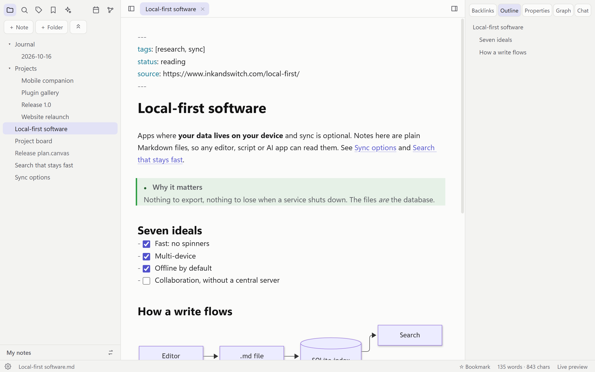
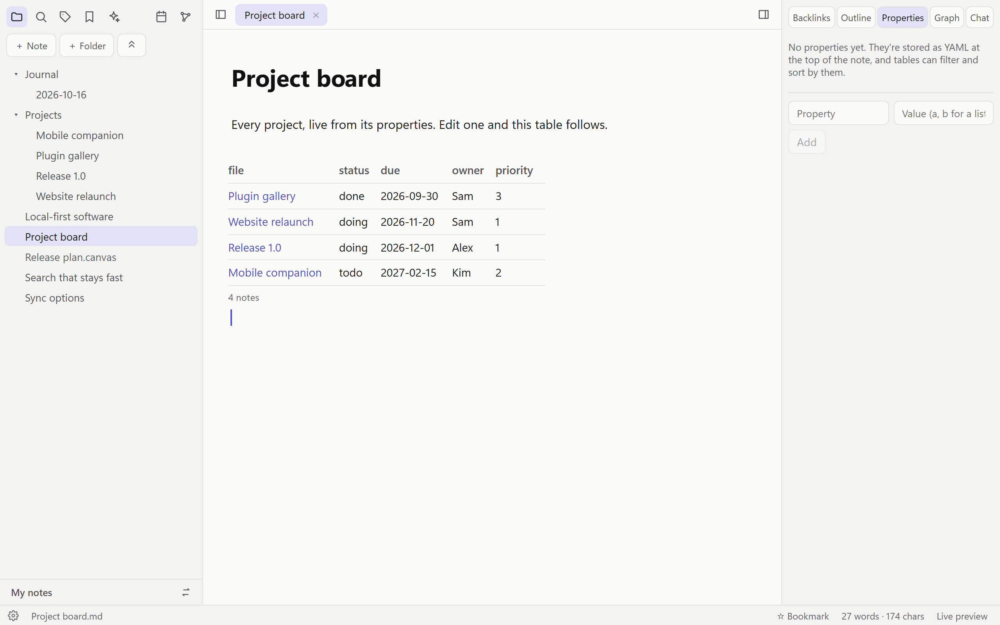
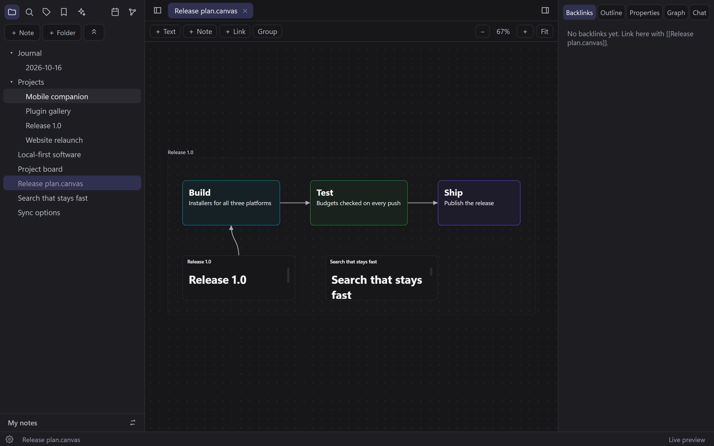
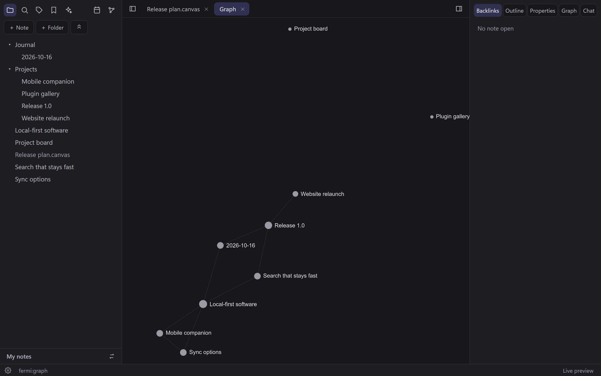

# FermiVault

[](https://github.com/pkud113/FermiVault/actions/workflows/ci.yml)

Fast, local-first Markdown notes that your AI apps can work with natively.



- **Plain files.** A vault is any folder of `.md` files. Nothing proprietary; app state lives in `<vault>/.fermi/`: the index and snapshots there can be rebuilt; settings and plugins live there too.
- **Fast.** Rust core + native webview (Tauri 2), SQLite FTS5 search, incremental indexing off the UI thread.
- **AI-native.** A built-in [MCP](https://modelcontextprotocol.io) server lets Claude Desktop, Claude Code, Codex, Cursor, VS Code, Windsurf, Gemini CLI and LM Studio search, read and edit your vault. Connect any of them with one click from the **AI apps** panel. Every agent edit is snapshotted so it can be undone.

## Download

Get the latest version from [**Releases**](https://github.com/pkud113/FermiVault/releases/latest), then pick any folder as your vault.

| OS | File | Notes |
|---|---|---|
| Windows 10/11 | `FermiVault_x.y.z_x64-setup.exe` | Installs for your user, no admin rights needed. An `.msi` is there too. |
| macOS 11+ (Apple silicon and Intel) | `FermiVault_x.y.z_universal.dmg` | Open it and drag FermiVault to Applications. |
| Linux (x64) | `.AppImage`, `.deb` or `.rpm` | AppImage: `chmod +x` it and run it. Debian/Ubuntu: `sudo apt install ./FermiVault_x.y.z_amd64.deb`. |

The apps aren't signed with a paid certificate yet, so your OS will warn you the first time:
- **Windows:** SmartScreen says "Windows protected your PC". Choose **More info → Run anyway**.
- **macOS:** the first open is blocked. Go to **System Settings → Privacy & Security** and choose **Open Anyway** next to the FermiVault message.

Git sync uses the `git` already on your computer: it comes with macOS (Xcode command-line tools) and most Linux systems; on Windows, get it from [git-scm.com](https://git-scm.com).

## Features

- Live-preview Markdown editor (CodeMirror 6) with source mode, `[[wikilinks]]` + autocomplete, formatting shortcuts, code highlighting
- Callouts (`> [!tip]`), task checkboxes (`Ctrl+L`), KaTeX math (`$…$`, `$$…$$`), Mermaid diagrams
- Embeds: `![[image.png|300]]`, `![[note]]`, `![[note#Section]]` (transclusion), PDFs, audio and video
- Graph view (global, `Alt+G`, and per-note local graph), tags pane, backlinks, outline
- Daily notes (`Ctrl+Shift+D`), templates with `{{title}}`/`{{date}}`/`{{time}}` (`Ctrl+Shift+T`), bookmarks
- File recovery: automatic snapshots (every 5 minutes while editing, before every AI-agent change), restore any version
- Vim key bindings (Settings, or "Toggle Vim key bindings"), loaded only when turned on
- Tabs and split panes, quick switcher (`Ctrl+O`), command palette (`Ctrl+P`), full-text search
- Link-safe rename/move (every `[[link]]` and `[x](note.md)` is rewritten)
- **Properties** (YAML frontmatter) edited in the right panel, with text, list, date and checkbox fields
- **Tables of notes**: a ```` ```table ```` block lists notes by tag or folder, filtered and sorted by their properties, live (see *Project board* in `fixtures/test-vault`)
- **Canvas**: infinite boards of text cards, notes, images, links and groups with arrows, stored as open [JSON Canvas](https://jsoncanvas.org) `.canvas` files (see *Planning board* in `fixtures/test-vault`)
- **Web clipper**: *Clip web page as a note* saves a page's article as Markdown (using [defuddle](https://github.com/kepano/defuddle)) with its title, author, date and source as properties, in a `Clippings` folder you can change in Settings
- **Git sync** (Settings → Sync): version history and sync through any Git host, by hand or every 5/15/60 minutes, using your installed `git`. If a note changed on both sides, your version stays and the other is saved next to it as a `(conflict …)` copy. Git only runs in vaults you set it up for on this computer
- **Plugins**: add commands and automate your vault in JavaScript. Each plugin runs in a sandboxed worker with no network access and only the permissions you approve (see [docs/PLUGINS.md](docs/PLUGINS.md))
- Interface in English, Español, Français and Deutsch (Settings → Language; follows the system by default). Adding a language is one JSON file: see [docs/TRANSLATING.md](docs/TRANSLATING.md)
- Image, PDF, audio and video viewers; file tree with drag-and-drop; trash instead of delete; light/dark themes
- Live reload when files change on disk (external editors, sync tools, agents)

Heavy renderers (KaTeX, Mermaid, the graph) load only when a note first needs them, so they never slow startup.

| Tables of notes | Canvas | Graph |
|---|---|---|
|  |  |  |

## Performance

FermiVault is built to stay fast as your vault grows. CI measures every change on a 10,000-note vault, on a Windows build machine without a GPU ([details](CONTRIBUTING.md#performance-budgets)):

| | Budget | Latest CI run |
|---|---|---|
| Full-text search | under 30 ms | 17 ms (slowest query) |
| Quick switcher | under 50 ms | 5 ms (on a PC) |
| Idle memory (app + WebView2) | under 150 MB | 103 MB |
| Installer | under 15 MB | 6.9 MB |
| Cold start to your vault | under 400 ms on a typical PC | 0.8 s on the GPU-less CI machine, ~0.5 s of it WebView2 starting |

## AI inside the app

- **Semantic + hybrid search.** Search ranks notes by keywords (BM25) and meaning together. Meaning comes from a local [Model2Vec](https://github.com/MinishLab/model2vec) model (`potion-base-8M`, ~30 MB, CPU-only, downloaded once from Settings → AI). Indexing runs in the background and re-embeds only paragraphs that changed.
- **Chat with your notes** (`Ctrl+J`). Answers are grounded in the most relevant passages and cite them; citations link to the source note.
- **Inline writing commands**: improve writing, fix spelling and grammar, summarize, continue writing (`Ctrl+Shift+Enter`). Results stream into the editor and undo with `Ctrl+Z`.
- **Related notes** with one-click linking, in the Backlinks panel.
- **Any model.** Chat and writing use any OpenAI-compatible server. Ollama, LM Studio and llama.cpp are detected automatically on localhost; hosted APIs work with a key stored in the OS keychain.

AI apps connected over MCP get the same hybrid `search` plus a `related` tool.

## Tables

````markdown
```table
from: #project, work/        (tags and/or folders; leave out for all notes)
where: status != done        (one condition per line: = != < <= > >= contains exists missing)
where: due < 2026-12-01
sort: due desc
columns: file, status, due
limit: 50
```
````

Fields are any property plus `file`, `path`, `folder`, `modified` and `tags`. Numbers compare as numbers, everything else as text, so ISO dates sort correctly. Agents use the same syntax through the MCP `query` tool.

## MCP tools

`search`, `read_note` (whole note or one section), `list_notes`, `recent_changes`, `links`, `related`, `query` (notes by properties and tags, as a table), `tags`, `create_note`, `edit_note` (`append` / `str_replace` / `replace_section` / `replace`), `rename_note`.

Run it manually:

```bash
fermivault mcp --vault /path/to/vault
```

## Privacy

- Your vault never leaves your computer unless you send it somewhere: chat and writing go only to the model server you pick in Settings → AI. Plain `http` is allowed only on your computer or local network, and API keys are only sent over `https` (or to your own computer).
- Images from the web in notes and AI answers wait for a click, so opening a note never contacts another server. Turn on *Load web images automatically* in Settings if you prefer.
- The semantic search model is downloaded once, on request, from a pinned Hugging Face revision and checked against its SHA-256.
- Security issues: see [SECURITY.md](SECURITY.md).

## Develop

Requirements: Rust (stable), Node 24, pnpm, and the [Tauri prerequisites](https://v2.tauri.app/start/prerequisites/).

```bash
pnpm install
pnpm tauri dev
```

See [CONTRIBUTING.md](CONTRIBUTING.md) for the project layout, tests and performance budgets. `fixtures/test-vault` is a small vault for trying things out.

## License

[MIT](LICENSE)
