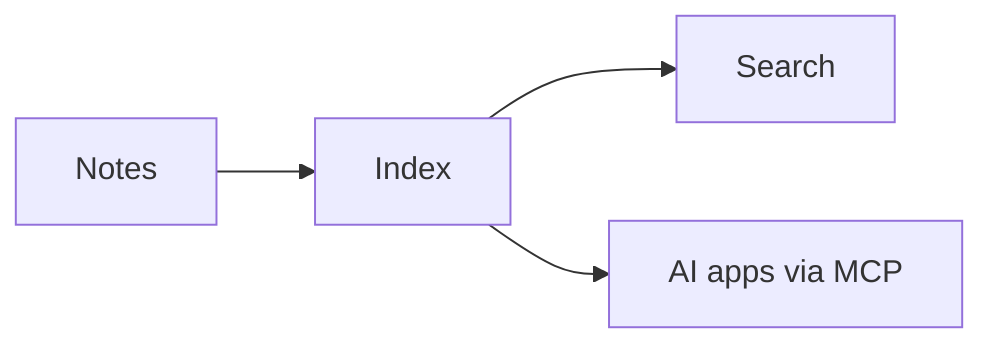

# Phase 2 showcase

> [!tip] Callouts
> Callouts render with a colored bar. They work with **any** Markdown inside.

> [!warning]
> A callout without a title shows its type.

> A plain quote stays a quote.

## Tasks
- [x] Graph view
- [ ] Ship phase 3

## Math
Inline math like $E = mc^2$ and a block:

$$
\int_0^\infty e^{-x^2}\,dx = \frac{\sqrt{\pi}}{2}
$$

## Diagram

## Embeds
![[diagram.svg|240]]

![[Getting Started#Connect your AI apps]]

![[sample.pdf]]
